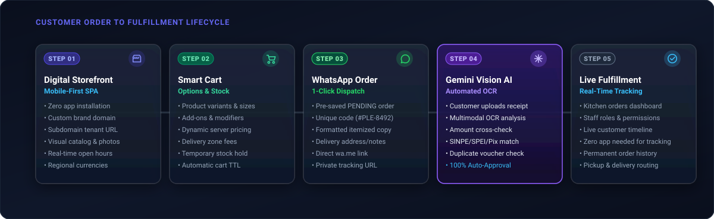
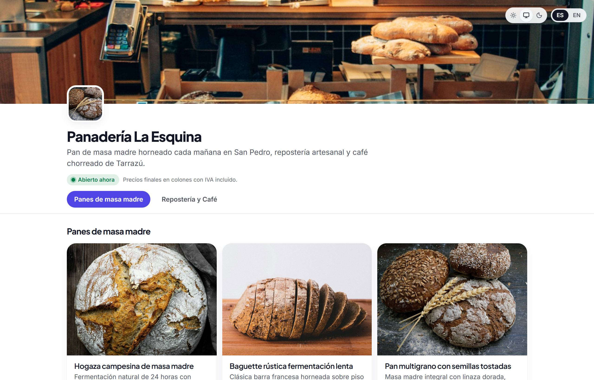
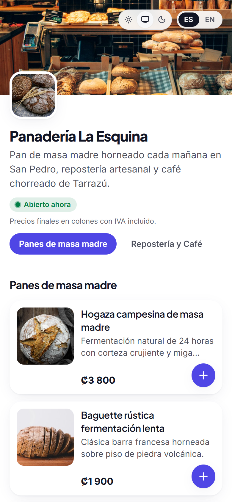
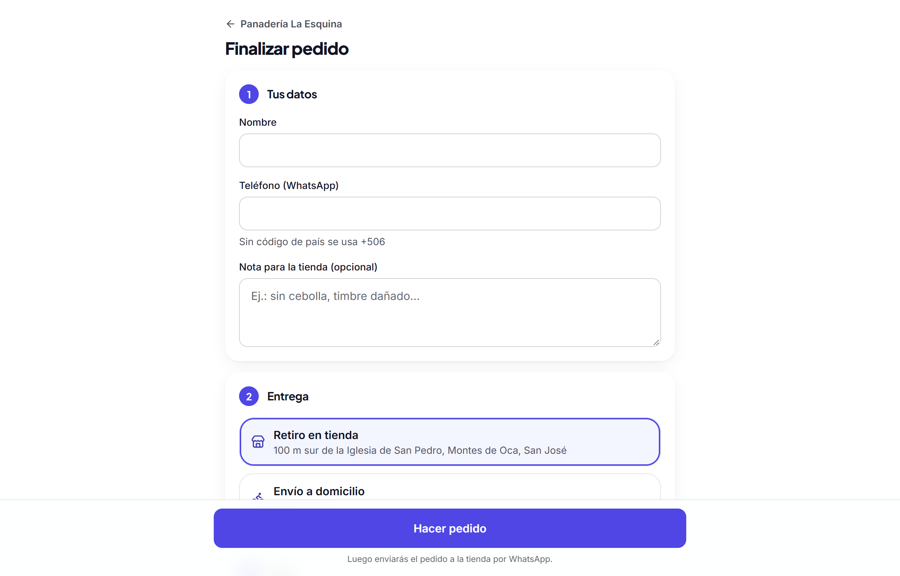
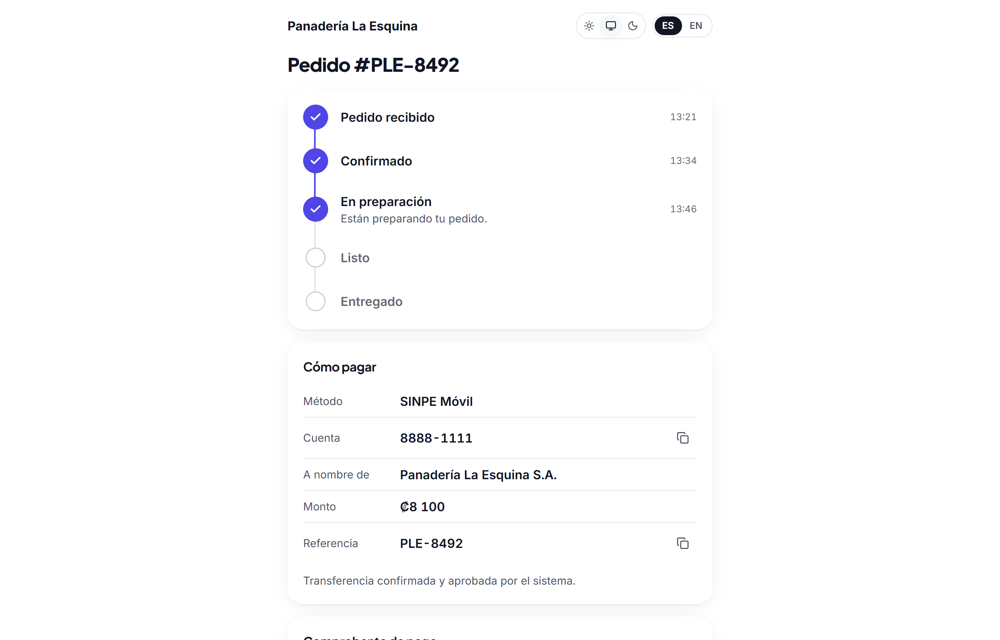
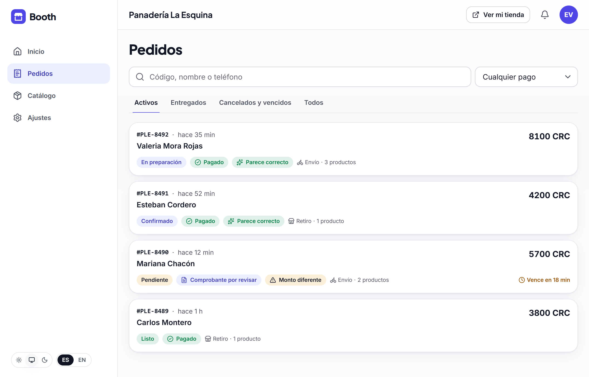
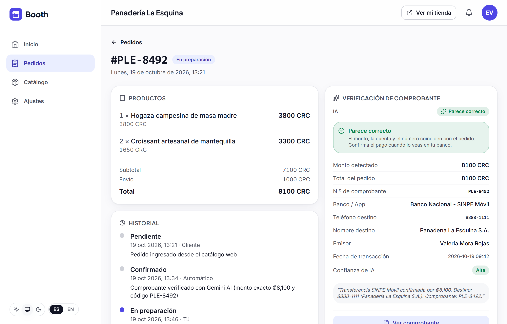
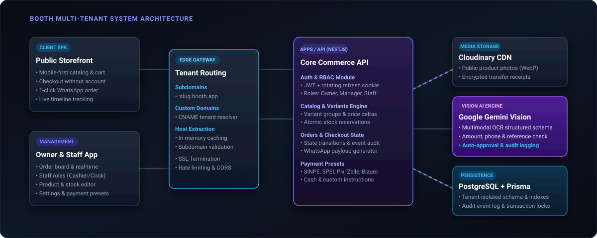

<p align="center">
  <picture>
    <source media="(prefers-color-scheme: dark)" srcset="docs/assets/hero-banner.svg">
    
  </picture>
</p>

<p align="center">
  <a href="https://github.com/keylorpineda/booth/actions/workflows/ci.yml">
    
  </a>
  <a href="#test-suite">
    
  </a>
  <a href="#architecture">
    
  </a>
  <a href="#ai-verification">
    
  </a>
  <a href="LICENSE">
    
  </a>
</p>

---

## The Problem with Selling Online Today

For artisan bakeries, specialty coffee roasters, neighborhood eateries, and independent creators, selling on modern digital channels is broken in two distinct ways:

1. **Marketplace Platforms (Delivery Apps):** Take 15% to 30% of every sale in fees, withhold customer contact data, and force small businesses into margin-crushing competition.
2. **Traditional E-Commerce (Shopify / WooCommerce):** Built for desktop shipping workflows, requires monthly subscriptions, asks customers to fill complex account registration forms, and fails to support the fast, conversational WhatsApp purchasing habits that dominate Latin America, Southern Europe, and emerging markets.

The result? Merchants resort to taking orders via unstructured WhatsApp text messages: _“What sizes do you have? How much is delivery? Send me the total.”_ The business owner spends hours each day answering the same questions, calculating subtotals by hand, manually checking bank apps to verify mobile transfer screenshots, and typing order statuses back to customers.

**Booth is the alternative.** A self-hosted, commission-free commerce engine that turns chaotic WhatsApp sales into an automated, structured, and verified digital workflow.

---

## How It Works

<p align="center">
  
</p>

1. **Frictionless Shopping:** Customers open the merchant's store (`store.booth.app` or custom domain) on their phone with zero app download or account creation required.
2. **Options & Stock:** Shoppers configure products (variants, sizes, extras, notes), see live prices with calculated delivery fees, and reserve inventory atomically.
3. **1-Click WhatsApp Order:** Checkout compiles the cart into a saved `PENDING` order with a unique reference code (`#PLE-8492`) and launches WhatsApp with a pre-filled, itemized message and tracking link.
4. **AI-Powered Receipt Verification:** When the customer pays via mobile bank transfer (SINPE Móvil, SPEI, Pix, Zelle, Bizum), they upload the receipt screenshot. Google Gemini Vision AI extracts the amount, phone number, and reference code to auto-approve the payment.
5. **Live Tracking & Fulfillment:** The customer monitors order progress on an unguessable tracking timeline, while the merchant and staff manage the kitchen workflow from a dedicated dashboard.

---

## App Screenshots

### 1. Digital Storefront Experience

The storefront provides an ultra-fast, mobile-first catalog that adapts to the merchant's custom branding, brand color, operating hours, and regional currency.

<p align="center">
  
</p>

<p align="center">
  
</p>

- **Zero-friction browsing:** Mobile-optimized categorized catalog with high-resolution imagery and badge indicators for available units.
- **Branded identity:** Custom logo, cover banner, brand accents, and operating schedule with automatic "Open Now" or "Closed" detection.
- **Smart cart drawer:** Real-time subtotal computation, quantity adjustment, and automatic order expiration countdowns.

---

### 2. Streamlined Checkout & Instant Order Tracking

Customers never have to create an account, remember passwords, or download an external application.

<p align="center">
  
</p>

<p align="center">
  
</p>

- **Fulfillment options:** Support for in-store pickup and granular delivery zones with localized fees.
- **Payment presets:** Built-in presets for SINPE Móvil (CR), SPEI (MX), Pix (BR), Nequi / Daviplata (CO), Yape / Plin (PE), Zelle / Venmo / Cash App (US), Bizum (ES), and cash on delivery.
- **Live customer tracking:** Secure unguessable token link where customers monitor the order timeline from `Pedido recibido` to `En preparación` and `Listo`, with copyable payment account numbers and reference codes.

---

### 3. Merchant Dashboard & Gemini AI Receipt Verification

Store owners and kitchen staff receive incoming orders in real time with automated payment verification powered by Google Gemini Vision.

<p align="center">
  
</p>

<p align="center">
  
</p>

- **Real-time orders board:** Filter by active orders, delivered, cancelled, or expired with live status badges.
- **Multimodal OCR validation:** Google Gemini Vision extracts transfer amounts, recipient phone numbers, and reference numbers directly from voucher images.
- **Automated reconciliation:** Matches transaction amounts against order totals with confidence scoring (`HIGH`, `MEDIUM`, `LOW`) and duplicate voucher detection.
- **Staff roles & permissions:** Multi-user store access with granular role separation (Owner, Manager, Staff / Cook).

---

## Architecture & Technology Stack

<p align="center">
  
</p>

### Monorepo Structure

| Workspace             | Technology                     | Responsibility                                                                                                                                         |
| :-------------------- | :----------------------------- | :----------------------------------------------------------------------------------------------------------------------------------------------------- |
| **`packages/shared`** | TypeScript, Zod                | Shared validation schemas, type definitions, ISO 4217 minor-units money engine, payment presets, and internationalization rules.                       |
| **`apps/api`**        | NestJS, Prisma ORM, PostgreSQL | Strict REST API, multi-tenant row-level isolation, JWT + rotating refresh cookie authentication, atomic stock reservations, and Gemini Vision service. |
| **`apps/web`**        | React 19, Vite, Tailwind CSS   | High-performance Single Page Application (SPA), storefront, checkout, live tracking, and merchant administration dashboard.                            |
| **`apps/web/e2e`**    | Playwright, Chromium, WebKit   | End-to-end browser automation suite testing full purchase flows across desktop and mobile viewports.                                                   |

### Engineering Highlights

- **Tenant Isolation:** Stores are isolated at the database level with scoped queries and unique code generations per store. Supports dynamic subdomains (`:slug.booth.app`) and custom CNAME domains.
- **Atomic Stock Management:** Products with inventory tracking reserve units upon checkout with time-to-live (TTL) auto-expiration to prevent overselling.
- **Tamper-Proof Pricing:** The client sends product identifiers and chosen options only; the server computes all unit prices, discounts, delivery fees, and order totals.
- **Zero ESLint Warnings:** Strict code quality enforcement across the entire codebase (`--max-warnings 0`) with automated formatting and lint-staged hooks.

---

## Getting Started

### Prerequisites

- **Node.js:** `v24.x` LTS (managed via `.nvmrc`)
- **Package Manager:** `pnpm` (`v9.x` or newer)
- **Database:** PostgreSQL `v16+` (or Docker for local container)

### Quickstart

1. **Clone the repository:**

   ```bash
   git clone https://github.com/keylorpineda/booth.git
   cd booth
   ```

2. **Install workspace dependencies:**

   ```bash
   pnpm install
   ```

3. **Configure environment variables:**

   ```bash
   cp apps/api/.env.example apps/api/.env
   cp apps/web/.env.example apps/web/.env
   ```

4. **Start local database & run migrations:**

   ```bash
   pnpm db:up
   pnpm --filter @booth/api prisma:migrate
   pnpm --filter @booth/api db:seed
   ```

5. **Start development servers:**
   ```bash
   pnpm dev
   ```

- **Web Application:** `http://localhost:5173`
- **Backend API:** `http://localhost:3000` (Swagger documentation at `http://localhost:3000/api/docs`)

---

## Demo Stores & Credentials

The local database seed includes two fully configured demo businesses:

| Store Name                | Country / Currency | Storefront URL      | Owner Email                | Password    |
| :------------------------ | :----------------- | :------------------ | :------------------------- | :---------- |
| **Panadería La Esquina**  | Costa Rica (`CRC`) | `/s/panaderia-demo` | `panaderia@demo.booth.app` | `Demo1234!` |
| **Bruma Coffee Roasters** | Colombia (`COP`)   | `/s/cafe-demo`      | `cafe@demo.booth.app`      | `Demo1234!` |

---

## Test Suite

Booth maintains comprehensive automated testing covering unit, contract, API integration, and browser end-to-end flows:

```bash
# Run unit and contract tests across all packages
pnpm test

# Run tests with code coverage reporting
pnpm test:cov

# Run Playwright browser end-to-end tests
pnpm --filter @booth/web test:e2e

# Run TypeScript typechecking across all workspaces
pnpm typecheck

# Run strict linter (zero warnings allowed)
pnpm lint
```

---

## Documentation Index

Detailed architectural and operational documentation is available in the [`docs/`](docs/) directory:

- [Architecture & Monorepo Design](docs/ARCHITECTURE.md)
- [Data Model & Prisma Schema](docs/DATA_MODEL.md)
- [API Specification](docs/API.md)
- [Production Deployment Guide](docs/DEPLOYMENT.md)
- [Product Roadmap & Milestones](docs/ROADMAP.md)
- [Engineering Devlog](docs/DEVLOG.md)
- [Payment Credentials Setup (Spanish)](docs/CREDENTIALS_SETUP.es.md)

---

## License

This project is licensed under the [MIT License](LICENSE).
